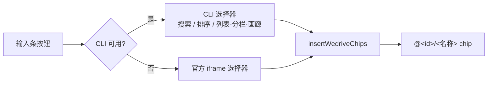

# wecom-file-dsh

DeepSeek Harness（DSH）插件：在对话输入条放一个企业微信微盘选择器，把选中的文件 / 文档 / 文件夹写成官方 `@` 引用 chip，再按 id 前缀交给对应的 `wecom-cli` 技能阅读。

**CLI 优先，iframe 回退**：默认走本机 `wecom-cli`（不需要浏览器登录，桌面版与 `dsh web` 表现一致）；机器上没有 CLI 时自动切到 `doc.weixin.qq.com` 的官方选择器。

- 安装配置：[docs/SETUP.md](docs/SETUP.md)
- 架构与目录：[docs/ARCHITECTURE.md](docs/ARCHITECTURE.md)
- 第三方资源：[THIRD_PARTY_NOTICES.md](THIRD_PARTY_NOTICES.md)



## 功能

- 输入条左侧工具栏增加「企业微信·微盘」按钮
- 弹层是 macOS 26 Finder 风格的毛玻璃窗口：统一工具栏 + 分段查看方式 + 排序菜单 + 搜索框 + 状态栏
- 窗口可拖动（拖标题或工具栏空白处），位置会被记住；标题也是键盘手柄，方向键微调、点击回到居中
- 三种查看方式、五个排序字段（升降序）、实时搜索、滚动加载更多、多选（最多 10 项）
- 授权失效时弹层内直接展示 `wecom-cli` 的扫码二维码
- 运行时技能 `wecom-wedrive-ref`（chip → `wecomcli-*` 路由）与 `wecom-wedrive-picker-setup`（安装 / 配置 / 排查）
- 两个 profile 都能装：桌面版（`dsh-app://app`）与 `dsh web`（`http://127.0.0.1:<port>`）

chip 文本：

- 文件 / 文档：`@<id>/<文件名>`，名称含空格时为 `@"<id>/<文件名>"`
- 文件夹：`@<id>/<文件夹名>/`

## 快速开始

```bash
# 1. 前置：wecom-cli ≥ 1.2.0 且已授权
wecom-cli --version
wecom-cli auth show --status        # 期望 authorized；否则 wecom-cli auth init --noninteractive

# 2. 装进目标 profile（desktop 或 web，按需替换）
cd "${DSH_HOME:-$HOME/.dsh}/profiles/desktop"
pnpm add wecom-dsh-plugins@link:/abs/path/to/wecom-file-dsh
# 再把 "wecom-dsh-plugins" 加进 package.json 的 dsh.profile.bundles

# 3. 重启应用 / 重开 dsh web
```

细节、Web profile、同站代理与故障排查见 [docs/SETUP.md](docs/SETUP.md)。

## 配置

配置写在 **profile 的 patch 层**（它在所有 bundle 层之后应用）：

```bash
# ${DSH_HOME:-$HOME/.dsh}/profiles/<desktop|web>/cordis.patch.yml
```

```yaml
- id: wecom-picker
  name: wecom-dsh-plugins
  config:
    placement: plusMenu     # standalone（默认）| plusMenu | both
```

改完重启应用（或重开 `dsh web`）。`id` 必须和 bundle 层插入的行一致（`wecom-picker`）。

| `placement` | 效果 |
| --- | --- |
| `standalone`（默认） | 只在输入条左侧工具栏显示独立按钮 |
| `plusMenu` | 只在输入条「+」菜单里显示一行，不占工具栏；弹层仍由同一个组件承载 |
| `both` | 两处都有，共用同一个弹层与偏好 |

不支持该配置的旧宿主/读不到配置时会回落到 `standalone`。

> **关于「+」菜单里的位置**：客户端贡献的行目前会落在菜单的**「命令」**分组，而不是 `文件` 所在的**「添加」**分组——DSH 把「添加」分组的成员硬编码在 `packages/client/ui-commands/src/client/presentation.ts` 的 `SECTION_ROWS.add`（`['file','goal','plan','feedback']`），插件贡献无法加入该组。要让它紧跟 `文件`，需要给贡献契约加一个可选的 `section` 提示（约 10 行，见 [docs/SETUP.md](docs/SETUP.md#让它紧跟文件可选)）。

## 界面

整窗是唯一一层 `backdrop-filter` 毛玻璃，工具栏 / 分栏 / 状态栏是叠在上面的半透明 token 填充，靠发丝分隔线和一道顶部高光分层；圆角只有 16 / 10 / 9 / 7 四档。

| 查看方式 | 说明 |
| --- | --- |
| 列表 | 可排序表头（再次点击同一列翻转方向），一行显示名称 / 种类 / 修改日期 / 大小 / 位置 |
| 分栏 | 位置 → 文件夹 → 项目 → 简介，四级联动；数据不足时自动退化成「项目 + 简介」两栏 |
| 画廊 | 大图舞台 + 底部胶片条，舞台显示当前项目的种类 / 位置 / 时间 / 大小与加入按钮 |

- **颜色**：DSH 的 `--dsw-alias-brand-primary` 是中性色（深色主题近纯白、浅色主题近纯黑），拿它做填充态会出现「文字与背景同色」；填充态一律走蓝色强调色（`--dsw-alias-brand-primary-new-colorprimary-new-color`，带 `--dsw-static-deepseek-500` 回退），纯文本态再向 `label-primary` 混 12%
- **焦点**：搜索框只保留一个提示——聚焦时输入框本身不画 outline / box-shadow，由容器边框 + 强调色光环表示
- **图标**：腾讯文档官方文件类型图标，已扣成内置组件（`src/client/assets/WedocsFileIcons.tsx`），不依赖 npm 包。在线文档走 20px 字形（`file-tdoc-20` / `file-smartdoc-20` / `file-space-20` …），微盘本地文件走 16px 字形（`file-pdf-default-inline` …）。类型映射见 `src/client/cli/model.ts` 的 `fileIconKey()`：先看 CLI `type`，只给 `file` 时按扩展名兜底
- **偏好**：排序与查看方式存 `localStorage`（`wecom-picker/preferences/v1`）
- **窗口**：弹层是可拖动的浮动窗口，不是钉在中央的固定模态——拖标题或工具栏空白处移动，窗口始终至少留 8px 在视口内，视口缩放时自动收敛；位置存 `localStorage`（`wecom-picker/window/v1`），下次打开还在原处。标题同时是键盘手柄：`↑/↓/←/→` 微调 16px（按住 `Shift` 为 4px），点击 / 回车 / 空格回到居中
- **键盘**：`Esc` 关闭、`Enter` 插入、`⌘/Ctrl+F` 聚焦搜索、`↑/↓/Home/End` 行间移动、`Space` 切换选中
- **数据现实**：CLI 未授权路径时返回占位文本 `无权限查看文件所在路径`，界面会把它当「未知位置」而不是显示出来；在线文档的 `file_size` 不是文件大小（智能文档会报 GB 级数字），只对普通 / 离线文件显示与排序大小

## 为什么默认不是官方 iframe 选择器

官方选择器（`doc.weixin.qq.com/webdisk/index?t=wedriveFileSelectorForWework` → `drive.weixin.qq.com`）**在 DSH 桌面版里无法登录**，这是第三方 iframe 的固有限制：

1. 桌面版页面 origin 是 `dsh-app://app`，选择器是跨站 iframe；WeCom 会话 cookie 默认 `SameSite=Lax`，在跨站 iframe 里既种不下也不会发送。
2. 官方登录面板只肯在 iframe 内运行，扫码成功后却用 `window.top.location = …/disklogin/login?code=…` **导航最顶层窗口**。
3. 桌面版对离开 `dsh-app://app` 的顶层跳转有围栏（`apps/desktop/src/main.ts:226`），会 `preventDefault()` 后 `shell.openExternal()`——表现成"只能跳外部浏览器"，而外部浏览器里的会话回不到 DSH。

所以官方选择器只作为回退保留（见 [架构](docs/ARCHITECTURE.md)），并且只在浏览器 + 同站代理下能真正登录。

## Chip 路由

| id 前缀 | 加载技能 | 查阅方式 |
| --- | --- | --- |
| `a1_` / `b1_` | `wecomcli-smartpage` | 智能文档正文 |
| `s3_` | `wecomcli-smartsheet` | 智能表格 |
| `d3_` 或其他不含 `.` 的 docid | `wecomcli-doc` | `wecom-cli doc contents get --json` |
| `s.` / `i.`（微盘条目，带点） | `wecomcli-disk` | 普通文件用 `disk files download` / `get`；在线文档不要 download，用返回的 `docid` 再走上行文档技能 |

`wecomcli-doc` 规定：`a1_` / `b1_` 不得当普通 doc 读。回复用户时用文档名，不要展示 id；有链接时写成 `[名称](url)`。

Chip 的 id 来源（`wecom-cli disk files list/search` 字段）：在线文档用 `docid`，普通文件和文件夹用条目 `id`；结果里没有 `docid` 时一律用条目 `id`。

## 宿主路由

浏览器侧用文档相对路径调用（`wecom-picker/…`），宿主按绝对路径注册，并复用 `connection` 的 Host/Origin 围栏：

| 路由 | 说明 |
| --- | --- |
| `GET /wecom-picker/status` | 授权状态、`wecom-cli` 版本、当前登录尝试（含授权链接） |
| `GET /wecom-picker/files?q=&cursor=&limit=` | `q` 为空走 `disk files list`（最近浏览），否则走 `disk files search`；`limit` 上限 100 |
| `POST /wecom-picker/auth/start` | 启动一次 `wecom-cli auth init --noninteractive --no-browser --output-qrcode qr.png` |
| `GET /wecom-picker/auth/qr.png` | 上述登录尝试写出的二维码图片 |

失败统一 `{ ok: false, state: 'missing' | 'unauthorized' | 'error', message }`；`missing` 用 503，其余 200。

## 开发

```bash
node --run test      # 零依赖测试（node:test）：模型纯逻辑 + 宿主路由，离线可跑
node --run bundle    # 重建 lib/client.js（产物入库，改动后必须一起提交）
```

- `tools/bundle.mjs` 自动定位 tsdown（`$DSH_TSUDOWN` → `$DSH_CHECKOUT` → 附近 checkout → PATH）
- 客户端产物**不要**引入需要运行时 `require()` 的 npm 包：client module table 只 materialize 平台模块，构建期解析不到的依赖会退化成运行时 `require`，表现为 `web boot: … did not activate`
- 宿主半由 Node 类型擦除直接加载 `src/host/*.ts`：**禁止**需要转译的语法（`enum`、参数属性 `constructor(private x)`、`namespace`）
- 改完产物后让 DSH 重新加载：桌面版重启应用最稳妥；`pnpm run dev:web` 在跑时客户端插件热重载
- 本仓库自带的 `tsconfig*.json` 是 standalone 的（不依赖某台机器的 checkout 路径）；需要完整类型检查时按文件内注释把 `extends` 指回你的 DSH checkout

### 三个标识（别混）

| 标识 | 值 | 用在哪 |
| --- | --- | --- |
| 包名 | `wecom-dsh-plugins` | profile 依赖、`cordis.patch.yml`、客户端打包 id（历史和安装记录依赖它，改名要同步改 profile） |
| 插件 id | `wecom-picker` | Cordis Loader 行 id、slot id |
| 仓库名 | `wecom-file-dsh` | 仓库与产品名 |

## 安全与权限

- 四个路由都在 DSH 宿主的 loopback HTTP 服务上，并先过 `connection.requestRejection` 的 Host/Origin 围栏，防止 DNS rebinding 与跨站网页驱动本地 CLI
- `wecom-cli` 通过 `ctx.subprocess` 以**固定 argv 数组**执行，不经过 shell；用户输入只作为 `--json` 参数值
- 单次调用有超时（20s / 探测 15s / 登录 10min）与输出上限（stdout 2 MiB、stderr 64 KiB）
- 唯一落盘的是登录二维码：`$DSH_HOME/storages/wecom-picker/qr.png`（文件名是常量）
- 插件不收集、不上传任何数据；所有请求都由本机 `wecom-cli` 按已授权身份发起

## 许可与第三方

本仓库当前 **UNLICENSED**（内部使用，`private: true`）。对外开源前需要所有者决定：

1. 选一个 SPDX 许可证并加 `LICENSE`，同时把 `private` 改成 `false`、补 `repository`；
2. 确认内置的腾讯文档文件类型图标可以再分发（上游包**未声明许可证**），或替换为自绘图标 —— 见 [THIRD_PARTY_NOTICES.md](THIRD_PARTY_NOTICES.md)；
3. 说明 `wecom-cli` 与 `@deepseek-ai/*` 的获取方式（均为内部资源，外部无法构建）。

安全策略见 [SECURITY.md](SECURITY.md)，参与开发见 [CONTRIBUTING.md](CONTRIBUTING.md)。
